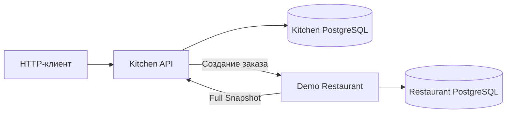

# Avito-Kitchen

Учебный backend-проект для интеграции ресторанов с клиентским приложением. Изначально создан в рамках тестового задания на Backend Intern и развивается как практический проект по проектированию, разработке, тестированию и эксплуатации распределённых систем.

Avito-Kitchen объединяет каталоги ресторанов и их филиалов, позволяет работать с корзинами и передавать заказы внешней системе ресторана.

## Возможности

- Просмотр ресторанов, филиалов и меню.
- Индивидуальные цены и доступность товаров в каждом филиале.
- Управление исходным каталогом через бизнес-сервисы Demo Restaurant.
- Полная HTTP-синхронизация каталога с контролем ревизий, контрольной суммой и дедупликацией.
- Базовые операции с корзиной, проверка актуальности заказа и checkout.
- Идемпотентный приём заказов рестораном и сохранение исторических данных заказа.

Проект находится в активной разработке. Полноценная аутентификация, административный HTTP API, расширенный жизненный цикл заказов, Kafka и веб-клиент относятся к следующим этапам. Подробный план — в [ROADMAP](docs/ROADMAP.md).

## Архитектура

В репозитории находятся два самостоятельных FastAPI-сервиса с независимыми PostgreSQL. Обмен данными между сервисами выполняется через HTTP API, а не через общую базу данных.



### Kitchen API

- Предоставляет клиентский REST API.
- Хранит локальное представление ресторанного каталога.
- Управляет корзинами и координирует оформление заказов.
- Принимает и атомарно применяет полные снимки каталога.
- Хранит локальные данные и результаты оформления заказов.

### Demo Restaurant

- Имитирует внешнюю информационную систему ресторана.
- Является источником истины по каталогу, ценам и доступности.
- Предоставляет бизнес-операции создания, изменения и деактивации каталожных сущностей.
- Формирует полные снимки каталога и отправляет их в Kitchen.
- Проверяет условия заказа, принимает или отклоняет его и сохраняет результат.

Административные endpoints для изменения каталога ещё не реализованы: существующие операции управления каталогом находятся на уровне бизнес-сервисов.

### Организация кода

Оба сервиса разделяют HTTP-слой, бизнес-логику и инфраструктуру:

| Слой | Ответственность |
|---|---|
| API / Pydantic schemas | HTTP-маршруты, валидация и контракты |
| Service | Бизнес-правила и координация операций |
| Repository | Доступ к PostgreSQL через SQLAlchemy |
| Unit of Work | Транзакционные границы, commit и rollback |
| Infrastructure clients | Межсервисное HTTP-взаимодействие |

## Синхронизация каталога

Используется **Full Snapshot Sync v3**: Demo Restaurant отправляет полное состояние ресторана, его меню, филиалов, товаров, цен и доступности. Частичные обновления (delta) пока не реализованы.

### Ревизии и транзакции

Demo Restaurant хранит общую `catalog_revision` в `catalog_state` (начальное значение — 0). Операции изменения каталога сериализуются через `SELECT FOR UPDATE`. Одна успешная транзакция с изменением итогового бизнес-состояния увеличивает ревизию на единицу. No-op, изменение с возвратом к исходному состоянию и rollback не увеличивают ревизию.

Snapshot строится в транзакции `REPEATABLE READ`, поэтому его данные и ревизия относятся к одному согласованному состоянию. Транзакция завершается до HTTP-отправки.

| Поле | Назначение |
|---|---|
| `snapshot_id` | UUID конкретного снимка; идентификатор повторной доставки |
| `schema_version` | Версия формата контракта, сейчас `3` |
| `catalog_revision` | Единая монотонная ревизия каталога ресторана |
| `generated_at` | Время формирования снимка для диагностики |

`generated_at` не определяет порядок применения. `branch_version` исключена из контракта v3; прежние внутренние поля пока сохранены для совместимости.

### Применение снимка в Kitchen

Kitchen вычисляет SHA-256 канонического бизнес-содержимого каталога. Порядок массивов и транспортные метаданные не влияют на checksum.

| Условие | Результат |
|---|---|
| Первый снимок или более высокая ревизия | `updated` — атомарное применение |
| Меньшая ревизия | `ignored / STALE_SNAPSHOT` |
| Та же ревизия и та же checksum, новый ID | `ignored / DUPLICATE_STATE` |
| Уже известный snapshot ID с совпадающим содержимым и ревизией | `ignored / DUPLICATE_SNAPSHOT` |
| Та же текущая ревизия с другой checksum или конфликт известного snapshot ID | HTTP `409 Conflict` |

Полный снимок может пропускать ревизии. Отсутствующие филиалы и товары деактивируются, отсутствующие связи становятся недоступными. Исторические ссылки сохраняются.

Текущие ревизия и checksum хранятся постоянно. История обработанных snapshot содержит идентификаторы, ревизии, checksum и время обработки. Записи старше 30 дней удаляются при последующей синхронизации соответствующего ресторана. Независимая периодическая очистка и автоматический HTTP retry остаются открытыми задачами; при повторной доставке одного снимка его ID и содержимое должны сохраняться.

В дальнейшем Kafka будет передавать delta-события, а полный HTTP snapshot останется механизмом первоначальной загрузки и восстановления после пропуска ревизий.

## API

Актуальные маршруты и DTO доступны в автоматически генерируемом Swagger UI каждого запущенного сервиса. Статическая [OpenAPI-спецификация](openapi/openapi.yaml) может отставать от исходного кода.

### Kitchen API — клиентские маршруты

| Метод | Путь | Назначение |
|---|---|---|
| GET | `/api/v1/restaurants` | Список ресторанов |
| GET | `/api/v1/restaurants/{restaurant_id}/branches` | Филиалы ресторана |
| GET | `/api/v1/branches/{branch_id}/menu` | Меню филиала |
| GET | `/api/v1/branches/{branch_id}/cart` | Корзина |
| POST | `/api/v1/branches/{branch_id}/cart/items` | Добавление товара |
| PATCH | `/api/v1/branches/{branch_id}/cart/items/{menu_item_id}` | Изменение количества |
| DELETE | `/api/v1/branches/{branch_id}/cart/items/{menu_item_id}` | Удаление товара |
| POST | `/api/v1/branches/{branch_id}/cart/checkout` | Оформление заказа |

Идентификаторы филиалов и товаров для клиентских маршрутов берутся из ответов Kitchen API. Для операций с корзиной пока используется заголовок `X-User-Email`. Это временная идентификация учебного MVP, **не механизм безопасной аутентификации**.

Пример добавления товара (UUID необходимо заменить реальными идентификаторами):

```http
POST /api/v1/branches/{branch_id}/cart/items
Content-Type: application/json
X-User-Email: customer@example.com

{
  "menu_item_id": "00000000-0000-0000-0000-000000000000",
  "quantity": 2
}
```

Пример тела запроса checkout:

```json
{
  "order_id": "external-order-123"
}
```

`order_id` идентифицирует логическую попытку оформления заказа.

### Kitchen API — интеграционные маршруты

| Метод | Путь | Назначение |
|---|---|---|
| POST | `/integration/v1/sync` | Приём полного snapshot v3 от Restaurant |
| POST | `/integration/v1/orders/validate` | Проверка заказа по каталогу Kitchen без создания заказа |
| POST | `/integration/v1/orders` | Координация создания заказа с обращением к Restaurant |

### Demo Restaurant API

| Метод | Путь | Назначение |
|---|---|---|
| GET | `/health` | Проверка доступности HTTP-сервиса |
| POST | `/sync` | Формирование и отправка полного snapshot в Kitchen |
| POST | `/orders` | Проверка и принятие либо отклонение заказа рестораном |

Restaurant повторно проверяет филиал, активность товаров, доступность и цены. Повтор того же `order_id` с тем же payload возвращает сохранённый результат; повторное использование ID с другим payload считается конфликтом.

## Модель данных

Основное хранилище — PostgreSQL. У каждого сервиса собственные SQLAlchemy-модели и Alembic-миграции.

| Сущность | Назначение |
|---|---|
| `Restaurant`, `RestaurantBranch` | Ресторан, филиалы и возможность принимать заказы |
| `Menu`, `MenuItem` | Общее меню ресторана, позиции и их глобальная активность |
| `BranchMenuItem` | Связь товара и филиала, цена и доступность |
| `CatalogState` (Demo Restaurant) | Ревизия и изменяемые метаданные каталога |
| `SyncSnapshot` (Kitchen) | История обработанных снимков |
| `Customer`, `Cart`, `CartItem` (Kitchen) | Покупатели и корзины по филиалам |
| `Order`, `OrderItem` (Kitchen) | Локальные заказы и исторические данные позиций |
| `RestaurantOrder`, `RestaurantOrderItem` (Demo Restaurant) | Решения ресторана и позиции принятых заказов |

Цена хранится в целых копейках (`RUB`) на уровне `BranchMenuItem`. Доступная позиция должна иметь положительную цену. `NULL` допустим для недоступной позиции. Один товар может иметь разные цены в разных филиалах.

Изменения каталога не должны менять исторические название, цену и количество товара в уже сохранённом заказе.

## Технологии

| Область | Стек |
|---|---|
| Backend | Python 3.13+, FastAPI, Pydantic |
| База данных | PostgreSQL 16, SQLAlchemy Async, asyncpg |
| Миграции | Alembic |
| HTTP | HTTPX, Uvicorn |
| Зависимости | uv |
| Проверки | pytest, pytest-asyncio, Ruff |
| Инфраструктура | Docker, Docker Compose |

## Структура репозитория

```text
avito-kitchen/
├── services/
│   ├── kitchen-api/
│   │   ├── app/
│   │   ├── alembic/
│   │   └── tests/
│   └── demo-restaurant/
│       ├── app/
│       ├── alembic/
│       └── tests/
├── docs/
│   ├── ROADMAP.md
│   ├── product/
│   │   ├── REQUIREMENTS.md
│   │   └── BACKLOG.md
│   ├── architecture/
│   ├── cjm/
│   └── database/
├── openapi/
│   └── openapi.yaml
├── AGENTS.md
├── docker-compose.yml
└── README.md
```

## Запуск проекта

### Docker Compose

Необходимы Docker и Docker Compose. Из корня репозитория:

```bash
docker compose up --build -d
docker compose ps
```

В текущей конфигурации Compose миграции обоих сервисов запускаются автоматически перед Uvicorn. Перед запуском с существующими volumes проверьте целевые базы и сделайте резервную копию при необходимости.

| Компонент | Адрес по умолчанию |
|---|---|
| Kitchen API | http://localhost:8000 |
| Kitchen Swagger UI | http://localhost:8000/docs |
| Demo Restaurant | http://localhost:8001 |
| Restaurant Swagger UI | http://localhost:8001/docs |
| Kitchen PostgreSQL | `127.0.0.1:5432` |
| Restaurant PostgreSQL | `127.0.0.1:5434` |

Порты относятся к конфигурации `docker-compose.yml` в репозитории; локальные изменения могут их переопределять. Внутри Docker-сети используются имена сервисов `kitchen-api`, `demo-restaurant`, `kitchen-db` и `restaurant-db`.

### Первичная синхронизация

После запуска обоих API вызовите `POST /sync` у Demo Restaurant (например, через Swagger UI):

```bash
curl -X POST http://localhost:8001/sync
curl http://localhost:8000/api/v1/restaurants
```

В PowerShell используйте `curl.exe` или `Invoke-RestMethod`. Снимок содержит фактическое состояние Restaurant DB; наличие филиалов и товаров зависит от наполнения каталога. Запуск контейнеров сам по себе не гарантирует наличие тестового ассортимента.

Просмотр логов и остановка:

```bash
docker compose logs -f kitchen-api demo-restaurant
docker compose down
```

Обычный `docker compose down` сохраняет именованные volumes. Не используйте `down -v` для удаления рабочих данных.

### Локальная разработка

Для работы вне Docker необходимы Python 3.13+, uv, отдельные PostgreSQL и настроенные параметры окружения. Каждый сервис имеет собственные зависимости; выполняйте команды из его каталога:

```bash
cd services/kitchen-api
uv sync
```

Для Demo Restaurant аналогично — из `services/demo-restaurant`.

Основные параметры:

| Сервис | Переменные окружения |
|---|---|
| Kitchen | `DATABASE_URL`, `DEMO_RESTAURANT_URL` |
| Restaurant | `DATABASE_URL`, `KITCHEN_API_URL`, `RESTAURANT_EXTERNAL_ID`, `RESTAURANT_NAME`, `RESTAURANT_DESCRIPTION` (необязательно), `MENU_EXTERNAL_ID`, `MENU_NAME` |

При локальном запуске указывайте адреса, доступные с хоста, а не внутренние Docker DNS-имена. Настройки названия ресторана и меню используются при инициализации legacy/начального состояния; после миграции изменяемые метаданные хранятся в `catalog_state`.

Не сохраняйте реальные credentials и секреты в Git.

### Миграции

Миграции находятся в `services/kitchen-api/alembic/` и `services/demo-restaurant/alembic/`.

Команда для соответствующего сервиса при локальном запуске:

```bash
uv run alembic upgrade head
```

Для уже работающего Compose (при необходимости ручного применения):

```bash
docker compose exec kitchen-api uv run alembic upgrade head
docker compose exec demo-restaurant uv run alembic upgrade head
```

Перед выполнением проверяйте фактическую целевую БД. При переходе с v2 на v3 необходимо остановить отправку снимков, применить миграции, обновить сначала Kitchen, затем Demo Restaurant и только после этого возобновить синхронизацию. Контракт v2 не поддерживается новым обработчиком v3.

## Тестирование и качество кода

Тесты находятся в каталогах `tests/` обоих сервисов. Каждый набор запускается отдельно из каталога соответствующего сервиса.

**Важно:** DB-тесты могут создавать, удалять и изменять таблицы и данные. Используйте только выделенные одноразовые тестовые PostgreSQL. Никогда не направляйте тестовые фикстуры в рабочие или общие базы. Для Kitchen учитывайте `.env.test`, для обоих сервисов проверяйте фактически используемые `TEST_DATABASE_URL` и `DATABASE_URL`, а также требования текущих фикстур к миграциям и начальному состоянию.

После подготовки безопасного окружения:

```bash
uv run pytest -q
uv run ruff check .
uv run ruff format --check .
```

Проверки выполняются в `services/kitchen-api` и `services/demo-restaurant`. Пропущенные DB-тесты не подтверждают корректность транзакций и миграций. Фактические результаты проверок фиксируются в соответствующих PR, а не выводятся из наличия тестовых файлов.

## Документация

| Документ | Назначение |
|---|---|
| [ROADMAP](docs/ROADMAP.md) | План разработки и текущий этап |
| [REQUIREMENTS](docs/product/REQUIREMENTS.md) | Согласованные бизнес-правила и инварианты |
| [BACKLOG](docs/product/BACKLOG.md) | Открытые задачи, технический долг и идеи |
| [AGENTS](AGENTS.md) | Правила работы Codex |
| [C4 Architecture](docs/architecture/architecture-c4.puml) | Архитектурная диаграмма |
| [Customer Journey](docs/cjm/user-cjm.puml) | Пользовательский сценарий |
| [Restaurant Journey](docs/cjm/restaurant-cjm.puml) | Сценарий ресторана |
| [ER Diagram](docs/database/er-diagram.puml) | Модель данных |
| [OpenAPI](openapi/openapi.yaml) | Статическое описание HTTP API |

Исходный код, миграции и автоматически генерируемый OpenAPI отражают текущую реализацию. Диаграммы и статическая спецификация могут требовать актуализации после изменений.

## Ограничения текущей версии

- Полноценная пользовательская и межсервисная аутентификация ещё не реализована; проект предназначен для локального учебного использования, а не публичного production-доступа.
- Admin API, расширенная конкурентная работа корзин, восстановление pending-заказов и доставка изменений статусов остаются дальнейшими задачами.
- Синхронизация выполняется полными HTTP-снимками; Kafka и delta-события запланированы.
- Веб-клиент, production monitoring и развёртывание развиваются отдельными этапами.
- Оплата, доставка и отмена заказов не входят в первую версию продукта.

Актуальные открытые задачи и технические ограничения ведутся в [BACKLOG](docs/product/BACKLOG.md).
